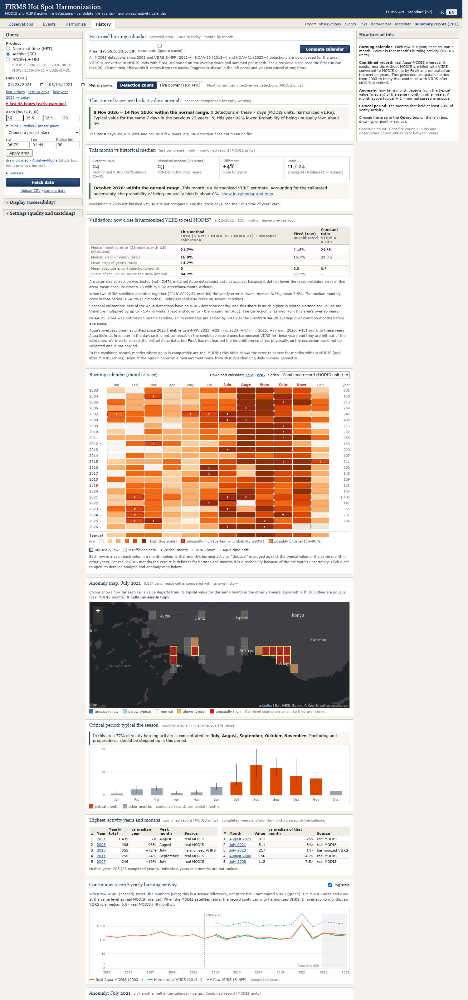
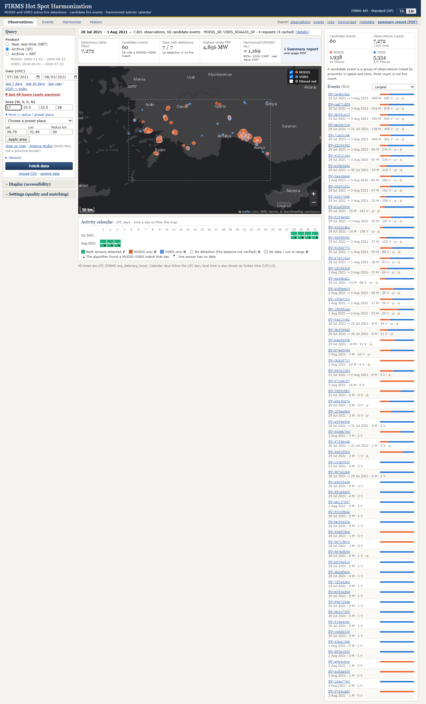
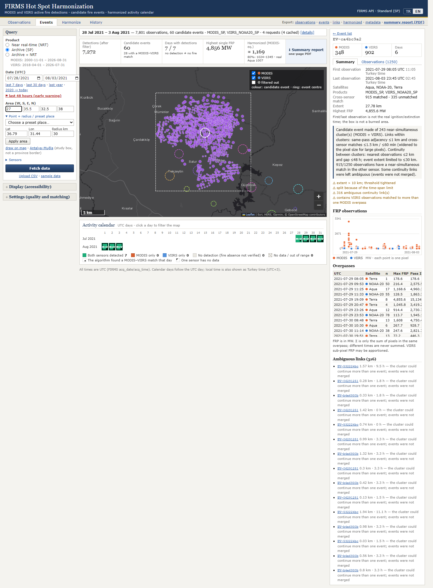
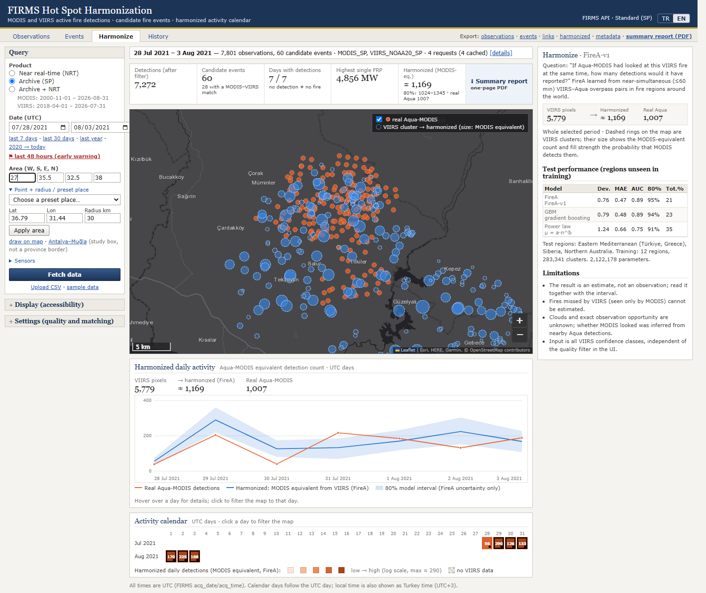
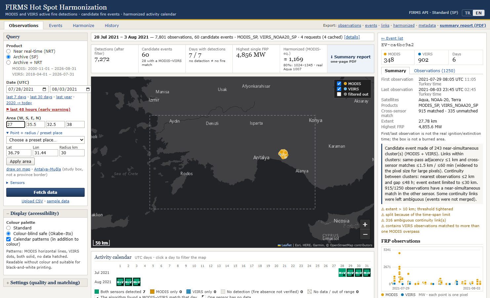
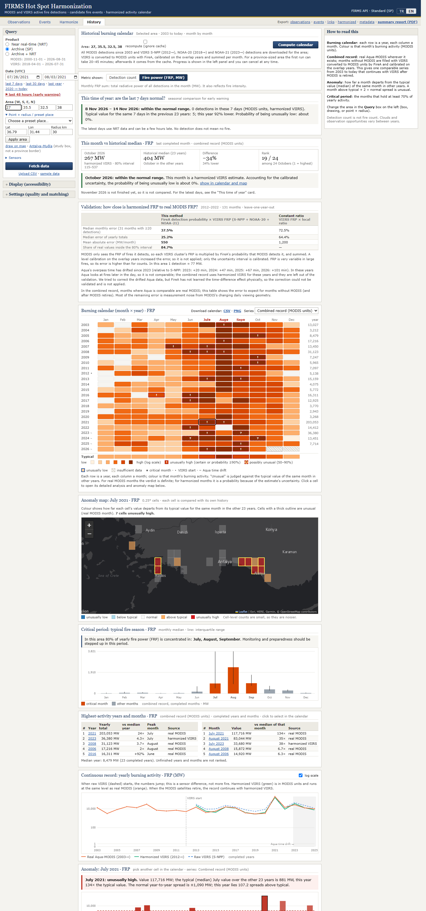
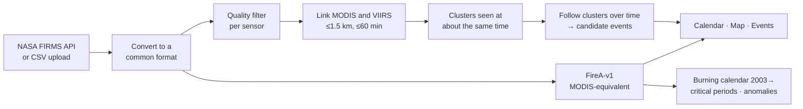
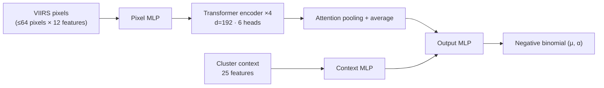

# FireA Harmonizer: MODIS and VIIRS Burning Activity Calendar

**English** · [Türkçe](README.tr.md)

Our project for the **NASA Space Apps Challenge 2026**, challenge **"Harmonization of MODIS and VIIRS Hot Spots"**.

Satellites have been recording active fires for more than 20 years, but this record comes from two different instruments, MODIS and VIIRS, whose numbers cannot be compared directly. We built a web app that:

1. converts VIIRS detections into MODIS-equivalent numbers, so the two records can be joined into one, and
2. uses this joined record to build a burning activity calendar for any area the user selects.

The app is meant for early-warning and emergency teams, scientists and land managers who want to look at past fire seasons, unusual months and critical periods.



---

## Contents

1. [The problem](#1-the-problem)
2. [What the app does](#2-what-the-app-does)
3. [Screenshots](#3-screenshots)
4. [How it works](#4-how-it-works)
5. [The FireA-v1 model](#5-the-firea-v1-model)
6. [Burning activity calendar, critical periods and anomalies](#6-burning-activity-calendar-critical-periods-and-anomalies)
7. [Early warning, accessibility and reports](#7-early-warning-accessibility-and-reports)
8. [Quick start](#8-quick-start)
9. [API reference](#9-api-reference)
10. [Retraining FireA](#10-retraining-firea)
11. [Project structure](#11-project-structure)
12. [Limitations](#12-limitations)
13. [Data sources and references](#13-data-sources-and-references)

---

## 1. The problem

Satellites find fires as hot spots: pixels that are much hotter than the area around them.

- **MODIS** flies on the Terra and Aqua satellites. Its pixels are about 1 km wide and its record starts in 2000.
- **VIIRS** flies on Suomi NPP (since 2012), NOAA-20 (since 2018) and NOAA-21 (since 2023). Its pixels are 375 m wide, about 7 times smaller in area, so it can see much smaller and cooler fires.

Because of this, the same fire can appear as 2 hot spots in MODIS and more than 10 in VIIRS. If the two records are simply put one after the other, fire activity seems to jump suddenly in 2012, even though nothing changed on the ground. Both MODIS satellites are also close to the end of their missions. If we want the long-term record to continue, VIIRS has to be expressed in MODIS units.

## 2. What the app does

The app is a single web page with four tabs. Each tab has its own address (`#gozlemler`, `#olaylar`, `#harmonize`, `#tarihsel`), so a view can be shared as a link. The interface can be switched between English and Turkish (TR | EN, top right), and server messages and the PDF report follow the chosen language.

| Tab | What it shows |
|---|---|
| **Gözlemler** (Observations) | Raw MODIS and VIIRS detections on a map, and a daily calendar showing which sensor saw fire on which day |
| **Olaylar** (Events) | Candidate fire events, grouped with simple rules that can be explained, and the details of each event (timeline, FRP chart, overpasses, uncertain links, raw records) |
| **Harmonize** | VIIRS detections converted into Aqua-MODIS-equivalent counts by FireA, compared day by day with real Aqua-MODIS, with an 80% uncertainty band |
| **Tarihsel** (History) | The burning activity calendar (month × year, 2003 to today), the critical period of the year, the continuous harmonized record and its validation, unusual months, an anomaly map, the same views for fire radiative power (FRP), a "this time of year" check, the last completed month compared with its historical median, and the highest-activity years and months |

Other features:

- **Choosing an area:** draw a box on the map, type coordinates, give a point and a radius, or pick one of the preset wildfire areas in Türkiye.
- **Data modes:** near-real-time data (NRT), the standard science archive (SP), or both together. The app never mixes them without saying so; the product used for each observation and each month is recorded.
- **Background jobs:** downloads and analyses run in the background, show their progress and can be cancelled. When FIRMS limits the number of requests, the app waits and tries again.
- **Exports:** observations (CSV), event summary (CSV), event–observation links (JSON), harmonized daily series (CSV), metadata (JSON), the burning calendar (CSV table, or PNG image with the same colours as on screen) and a one-page PDF report. The API key is never written into any export.
- **CSV upload** for archive files, and a synthetic sample dataset that is clearly labelled as such (`?ornek=1`).

## 3. Screenshots

| | |
|---|---|
|  **Observations:** 28 Jul – 3 Aug 2021 (Manavgat and Marmaris fires), real FIRMS SP data |  **Events:** one candidate event with its explanation, FRP values and overpasses |
|  **Harmonize:** VIIRS converted to MODIS-equivalent counts, compared with real Aqua-MODIS |  **Accessibility:** colour-blind safe palette and patterns in the calendar |
|  **History · FRP:** harmonized fire radiative power, its validation and the anomaly map | |

## 4. How it works



### 4.1 Getting the data from FIRMS

- We use the FIRMS **Area API** (`/api/area/csv/{KEY}/{SOURCE}/{W,S,E,N}/{DAYS}/{DATE}`) and the **Data Availability API**.
- Supported products: `MODIS_NRT`, `MODIS_SP`, `VIIRS_NOAA20_NRT`, `VIIRS_NOAA20_SP`, `VIIRS_SNPP_NRT`, `VIIRS_SNPP_SP`.
- The app first checks which dates each product covers. Days outside that range are not downloaded and are marked in the interface. The app does not quietly switch to other dates.
- Long periods are split into 5-day pieces and downloaded in parallel. Answers are stored in a local SQLite cache, so the same request is never downloaded twice. Recent NRT data stays in the cache for 20 minutes.
- Different errors are shown separately: wrong key, request limit (with automatic waiting), timeout, network error, empty result and out-of-range day.
- The key is only read on the server. It is hidden in all logs and error messages and is never sent to the browser.

### 4.2 Common data format

Every record is converted to these fields:
`observation_id, source, satellite, instrument, latitude, longitude, observed_at_utc, frp_mw, confidence_raw, scan_km, track_km, daynight, version`.

The original record is kept next to it.

- `acq_date` and `acq_time` (HHMM, UTC) are combined into `observed_at_utc`. Times written without leading zeros are read correctly (`631` → 06:31).
- If FRP is missing it stays empty; it is never replaced with 0.
- `observation_id` is a fixed hash of the record, so downloading the same data again does not create duplicates. Detections from different satellites or times at the same place are kept.
- Each sensor has its own quality filter: a confidence threshold (0–100) for MODIS and the `l/n/h` classes for VIIRS. We do not convert one scale into the other.
- Static heat sources, volcanoes and offshore detections (`type` 1–3) are left out of the burning calendar.

### 4.3 Candidate events

Events are built with a few simple rules, so that every grouping can be explained:

| Step | Rule | Default |
|---|---|---|
| Overpass | detections of one satellite that come one after another within a short time | 10 min |
| MODIS–VIIRS link | distance (Haversine) and time difference between a MODIS and a VIIRS detection | ≤1.5 km, ≤60 min (larger for big MODIS pixels near the edge of the swath) |
| Neighbours in one overpass | pixels next to each other in the same overpass | ≤1 km (depends on pixel size) |
| Cluster | connected groups with limits on duration and size | ≤90 min, ≤10 km |
| Continuing over time | distance and time gap between clusters | ≤2 km, ≤48 h, event size ≤30 km |
| Uncertain cases | if a cluster could belong to two events, it is added to the closer one and the other link is saved as uncertain; events are never merged | — |

- All thresholds are experimental and can be changed in the interface.
- The first and last detection of an event are not its real start and end time, and an event's box is not the burned area.
- The daily calendar shows five kinds of days: *both sensors*, *MODIS only*, *VIIRS only*, *no detection (this does not prove there was no fire)* and *no data / out of range*. Days on which a MODIS and a VIIRS detection were actually linked are marked separately.
- FRP is shown in MW for each detection. Values from different times are never added up.

Speed: linking 26,000 detections takes about 6 seconds. A 3-day period with 73,000 detections takes about 20 seconds, plus about 6 seconds for FireA.

## 5. The FireA-v1 model

FireA answers one question: *if Aqua-MODIS had looked at this VIIRS fire at the same moment, how many detections would it have reported?*

For each VIIRS cluster (nearby pixels from one overpass), FireA does not give a single number. It gives a probability distribution (negative binomial) for the MODIS detection count. From this distribution we get:

- the expected number of MODIS detections, and
- the probability that MODIS would detect the cluster at all.

### 5.1 Training data

- **Products:** NASA FIRMS archive products MODIS C6.1, VIIRS S-NPP and VIIRS NOAA-20, 2019–2024.
- **Regions:** 15 regions with different fire types (Mediterranean, boreal forest, savanna, tropical forest, crop burning, peatland). From each region we took 50 days: 26 from the fire season and 24 spread over all 12 months, so the model also sees winter and quiet periods. In total this was 2,250 requests and 3.58 million detections.
- **Label:** the number of Aqua-MODIS detections on the VIIRS cluster in the Aqua overpass closest in time (at most 60 minutes apart).
- **Did MODIS look there?** Hot-spot files do not say whether a satellite looked at an area or whether it was cloudy. We only used a cluster if there were other Aqua detections 10–1,000 km away in the same overpass, which shows that MODIS was imaging the area. Detections on the cluster itself were not counted, because then the label would decide whether a cluster gets into the data.
- **Other inputs:** cluster size, FRP, brightness, confidence, viewing geometry, local time, season (taking the hemisphere into account), absolute latitude, and the number of VIIRS pixels within 25 km in the same overpass.
- **Size of the dataset:** 1,264,656 clusters, of which 1,062,634 could be used. With at most 50,000 per region we had 283,341 clusters for training, 55,423 for validation and 61,064 for testing.
- **Test regions:** Eastern Mediterranean, Siberia and Northern Australia. The model we evaluated never saw these regions.
- **Model used in the app:** retrained on all regions except the Eastern Mediterranean (389,974 clusters). We kept this region out so that our checks there, including the Antalya–Muğla area, stay independent.

The data itself shows why harmonization is needed: MODIS detects only **8%** of VIIRS clusters that have a single pixel, but **66%** of clusters with more than 20 pixels.

### 5.2 Model



- **Type and size:** a set transformer with 2,122,178 parameters. A set transformer treats the pixels of a cluster as an unordered group, which suits fire clusters.
- **Training:** negative binomial loss, AdamW optimizer, 5 epochs, batch size 512, on a normal computer's CPU (about 30 minutes for the final model).
- **Using it in the app:** we assume both satellites look at the same moment (Δt = 0). Because we do not know from which angle MODIS would see the fire, we predict for 16 typical pixel sizes and take the average. The 80% intervals of daily and monthly totals are computed with Monte Carlo sampling.

### 5.3 Results in the test regions (61,064 clusters)

We compared FireA with two simpler methods:

| Model | Poisson deviance ↓ | MAE ↓ | Detection AUC ↑ | Brier ↓ | 80% interval coverage | Region-day total error (median) ↓ |
|---|---|---|---|---|---|---|
| Power law (μ = a·n^b) | 1.243 | 0.663 | 0.754 | 0.165 | 90.8% | 35.4% |
| Gradient boosting (Poisson) | 0.788 | 0.478 | 0.889 | 0.113 | 93.8% | 22.5% |
| **FireA-v1** | **0.764** | **0.468** | **0.891** | **0.111** | 94.9% | **20.9%** |

What these numbers mean:

- FireA is clearly better than the simple power law (39% lower deviance).
- It is better than gradient boosting on every metric, but only by a small margin (3% lower deviance).
- Its 80% intervals are a little too wide: they contain about 95% of the real values.
- Over all test clusters, FireA predicted 35,426 MODIS detections. The real number was 34,634 (+2.3%).

### 5.4 Does it bring the two sensors together? (Antalya–Muğla, 2012–2022)

- In the 49 months when both sensors were working and there were at least 20 detections, raw VIIRS reported a median of **6.6 times** as many detections as real Aqua-MODIS. After FireA-v1, without any local calibration, this ratio is **0.91**.
- Large fire months come out close to the real values. For August 2021 FireA gives 771 detections; real Aqua-MODIS reported 811 (−5%).
- Quiet months are less accurate. For example, for August 2016 FireA gives 17 while the real value is 6.
- The validation of the full method, done by leaving out one year at a time, is in section 6.4.
- **One week as an example (Manavgat, 28 July – 3 August 2021):**
  - From NOAA-20 data FireA-v1 predicts 1,169 detections and from S-NPP data 1,080. Aqua-MODIS really reported 1,007 (+16.1% and +7.2%).
  - A constant ratio (0.149 MODIS detections per VIIRS pixel) gives 859 (−14.7%).
  - For a single week with a very large fire, FireA is not clearly better than the constant ratio. Its advantages show up in quiet periods, in the uncertainty estimate and when several satellites are averaged.

More details: [`backend/models/FireA-v1/MODEL_CARD.md`](backend/models/FireA-v1/MODEL_CARD.md).

## 6. Burning activity calendar, critical periods and anomalies

The **Tarihsel / History** tab builds the full record for the selected area in three steps:

1. It downloads all MODIS detections since 2003 and the VIIRS detections of three satellites: S-NPP since 2012, NOAA-20 since 2018 and NOAA-21 since 2023. It uses the archive (SP) where it exists and NRT data otherwise.
2. It converts VIIRS to MODIS units with FireA and calibrates the result using the years in which both sensors worked.
3. It adds everything up month by month, both as **detection counts** and as **fire radiative power (FRP, MW)**.

A switch at the top changes all views between counts and FRP. The burning calendar can be downloaded as a CSV table (all series, source, 80% interval and unusualness for each month) or as a PNG image with the same colours as on screen.

| View | Question it answers |
|---|---|
| **Validation** | How close is harmonized VIIRS to real MODIS in this area? (tested by leaving out one year at a time, and compared with the raw model and a simple constant ratio) |
| **Burning calendar (month × year)** | When was there fire, and how much, in each month since 2003? Unusual months are marked; for harmonized months the mark is based on a probability |
| **Anomaly map** | Which parts of the area were unusual in the selected month? The area is divided into cells of about 0.25° (at most 24 × 16), and each cell is compared with its own past values for the same month |
| **Critical period** | When is the usual fire season? Monthly medians with their spread; the months that together hold at least 70% of the yearly activity are marked as critical |
| **Continuous record** | Yearly totals from 2003 to today: real MODIS, harmonized VIIRS (in MODIS units) and raw VIIRS. The jump in the raw series in 2012 is caused by the change of sensor |
| **Single month** | For a clicked month: its value, the typical value of the same month in other years, the "unusual" threshold and, for harmonized months, a probability |
| **Sensor agreement** | Over the years, does harmonized VIIRS (with its 80% interval) match real MODIS for that month? |
| **This time of year** | The last 7 days compared with the same 7 days in earlier years, as an early-warning check |
| **This month vs historical median** | How does the last completed month compare with the same month in all other years? Value, historical median, difference, rank and verdict (for harmonized months with a probability) |
| **Highest-activity years and months** | The five busiest years and the five busiest months, each compared with a typical year or month and marked as real MODIS or harmonized VIIRS |

### 6.1 Which satellites we use, and why NOAA-21 is included

The challenge is about the **MODIS** and **VIIRS** records. These are the names of instruments, not satellites:

- **MODIS** is on Terra and Aqua. We use **Aqua** as the reference, because it passes in the early afternoon like VIIRS. Terra passes in the morning.
- **VIIRS** is on three satellites with the same instrument design and the same 375 m fire algorithm: **Suomi NPP** (2012→), **NOAA-20 / JPSS-1** (2018→) and **NOAA-21 / JPSS-2** (2023→). All three are VIIRS hot-spot records published by NASA FIRMS, so including NOAA-21 stays within the challenge.

NOAA-21 is important for the future. S-NPP is the oldest VIIRS satellite, and after MODIS stops, the record will have to continue with the newer ones.

How the satellites are combined:

- FireA is run separately for each VIIRS satellite and the monthly results are averaged, not added. Each satellite sees the same fires on its own, so averaging reduces random error. Adding NOAA-20 lowered the monthly error from 30.8% to 27.5% over 103 shared months.
- FireA was trained only on S-NPP and NOAA-20 data, and its raw estimates from NOAA-21 were 16% higher than from S-NPP. We also cannot check NOAA-21 against Aqua, because Aqua's orbit had already started drifting when NOAA-21 began.
- So before averaging, NOAA-21 is scaled so that its total over the shared months equals the S-NPP/NOAA-20 average. In the Antalya–Muğla area the factor is ×0.82. Month by month, NOAA-21 follows S-NPP very closely (log correlation 0.975). If an area has fewer than 6 shared months, NOAA-21 is not used.
- The "raw VIIRS" series shown for comparison uses only S-NPP, so that it is the same sensor from 2012 onwards.

### 6.2 How the harmonized record is built

1. **Cluster-size correction (only where it helps).** For the years when both sensors worked, the app matches each Aqua detection to the nearest VIIRS pixel (within ±90 minutes and the MODIS pixel size). It then compares the matched counts with FireA's estimates for five cluster sizes, separately for day and night, and computes correction factors. These factors are used only if they lower the error in the leave-one-year-out test. In the Antalya–Muğla area they do not (mean absolute error 5.26 with the correction and 5.02 without), so the correction is skipped there.
2. **Seasonal calibration.** About a third of the Aqua detections in the study area (32% in 2012–2022) have no VIIRS detection anywhere nearby. This share is 60–80% in winter and spring and only 13–20% in July and August. FireA cannot predict these detections from VIIRS clusters. Instead, the app learns a smooth seasonal factor from the months when both sensors worked (one yearly sine wave, fitted with a Poisson model and regularization). In the study area this factor is small: ×1.47 in February and ×0.90 in August. If there are fewer than 36 shared months, a single overall factor is used instead.
3. **Harmonized FRP.** MODIS only measures the FRP of fires it detects. So for each VIIRS cluster, the app multiplies its FRP by FireA's probability that MODIS would detect it, and adds these up. Calibrating FRP by season or by an overall factor made the error larger in our tests, so FRP is used without scaling; only its uncertainty interval is calibrated.
4. **Calibrated uncertainty.** The 80% intervals are based on the real monthly errors in the years when both sensors worked. The width of the interval depends on the size of the value and is adjusted so that 80% of the real values fall inside. The model's own intervals contained only 63% of the real values.
5. **Aqua's orbit drift.** Aqua left its usual orbit group (the A-Train) in 2022, and since then it passes later every year. The app measures this from the data by comparing the typical local overpass times of Aqua and S-NPP. In the study area the delay was 20 minutes in 2023, 47 in 2024, 67 in 2025 and 101 in 2026. Years with more than 15 minutes of drift are not used for calibration or validation; for those years the combined record uses harmonized VIIRS.
6. **Combined record (MODIS units).** The combined record uses real Aqua-MODIS wherever it can be compared, and calibrated harmonized VIIRS everywhere else: in drifted years, in months with missing MODIS data and, in the future, after MODIS stops.

**Why we do not correct the drifted Aqua data:** we tested whether FireA could do it by giving it the real time difference between Aqua and VIIRS instead of Δt = 0. It could not. With the real time difference the 2024–2025 predictions went slightly down (ratio to Aqua 0.85 → 0.83 and 0.80 → 0.80) instead of up, which means the model has not learned how fires change during the day. We also tried a simple factor taken directly from the data, but the drift effect (−15% to −20%) was the same size as normal differences between years (2022 was −18% without any drift). So drifted Aqua data is shown in the app but not used as the reference.

### 6.3 Unusual months

- **Typical value:** the median of the same month in the other years. **Normal spread:** 1.4826 × median absolute deviation, but at least 5 detections (or the FRP equivalent), so that very quiet months are not marked for small changes.
- For **months with real MODIS data**, the result is clear: above *typical + 2 × spread* is **unusually high**, below *typical − 2 × spread* is **unusually low**.
- For **harmonized months** the value is itself an estimate. Using the calibrated error, the app computes the **probability** that the real MODIS value is beyond the threshold, for example "unusually high, probability 93%". In the calendar, "!" means at least 90% and "?" means 50–90%.
- The anomaly map uses the same method for each cell, with a lower minimum of 3 detections, because counts in small cells vary more.
- Months with data on less than 90% of their days are left empty (hatched). "No detection" is never treated as "no fire".

### 6.4 Example: Antalya–Muğla (27–32.5°E, 35.5–38°N), 2003 to November 2026

We tested the method against real Aqua-MODIS for 2012–2022 by leaving out one year at a time: everything is learned from the other years and then compared with the year that was left out. There are 131 months; the percentage errors are for the 31 months with at least 20 detections.

| Detection count | **Our method** (FireA-v1, S-NPP + NOAA-20 + NOAA-21, seasonal calibration) | FireA-v1 without calibration | Constant ratio (VIIRS × 0.149) |
|---|---|---|---|
| Median monthly error | **21.7%** | 21.5% | 24.8% |
| Median error of yearly totals | **16.9%** | 15.7% | 23.3% |
| Mean error of yearly totals | **14.7%** | — | — |
| Mean absolute error (detections per month) | **5.0** | 5.5 | 6.7 |
| Real values inside the 80% interval | **84.7%** | 67.2% | — |

FireA-v1 is already close to the real values without calibration. The seasonal calibration mainly lowers the absolute error and makes the intervals reliable.

In 2018–2022, when two VIIRS satellites were available (57 months), the error of yearly totals is much smaller: median 3.7%, mean 7.5%. The median monthly error in this period is 24.2% (12 months with at least 20 detections).

| FRP | **Our method** (FireA detection probability × VIIRS FRP) | Constant ratio (VIIRS FRP × local ratio) |
|---|---|---|
| Median monthly error | **37.5%** | 72.5% |
| Median error of yearly totals | **25.2%** | 64.4% |
| Mean absolute error (MW per month) | **550** | 1,200 |
| Real values inside the 80% interval | **84.7%** | — |

What the record shows for this area:

- **Raw VIIRS compared with MODIS:** in months when both worked, raw VIIRS reported a median of 6.6 times as many detections as Aqua-MODIS. Joining the raw records would create a false jump in 2012.
- **Critical period:** 77% of the yearly detections fall between July and November. July–September holds 80% of the yearly fire power, because the largest fires happen in midsummer.
- **Unusual months:** 27 months are marked as unusually high (certain, or with a probability of at least 90%). Among them are July–August 2008 and July–August 2021, the months of the Manavgat fire (511 and 811 detections, while the typical values are 15 and 33). The anomaly map for July 2021 marks the cells around Manavgat and Marmaris.
- **Large fire months:** harmonized VIIRS gives 567 for July 2021 (real Aqua: 511) and 771 for August 2021 (real: 811). Both real values are inside the 80% intervals (479–671 and 654–909).
- **Months after MODIS drift:** July 2023 is unusually high with a probability above 99%, September 2025 with a probability of 53%.

The remaining monthly error (about 20% for counts and 38% for FRP) has two main causes. The first is the detections that only MODIS sees; VIIRS gives us no information about them. The second is measurement noise: MODIS sees a fire from a different angle and with a different pixel size every day, and the FRP of large fires changes a lot from one overpass to the next. We also tried machine-learning corrections at the cluster level, a separate model for the small MODIS-only detections, and merging the VIIRS satellites into shared fire objects. None of them did better than the method above in the leave-one-year-out test.

The first calculation for an area the size of a province takes about 20–45 minutes, because the app downloads about 4,000 pieces from FIRMS while staying within the request limit. After that, results come from the cache.

## 7. Early warning, accessibility and reports

- **Early warning:**
  - "Last 48 hours" selects the newest NRT data.
  - The page can refresh itself every 30 minutes; when a new NRT day appears, the time window moves forward.
  - The browser can show a desktop notification when new fires are detected.
  - Events can be sorted by newest detection or highest FRP. Events with a detection in the last 12 hours get a **NEW** label.
  - The "this time of year" check compares the last 7 days with earlier years.
  - NRT data arrives about 3 hours after the overpass, and notifications only work while the page is open.
- **Language:** English or Turkish, changeable at any time. The browser remembers the choice.
- **Accessibility:**
  - A standard palette or the Okabe–Ito palette, which is safe for colour-blind users.
  - The calendar uses patterns as well as colours (lines for MODIS, dots for VIIRS, hatching for missing data).
  - The burning calendar uses shades of a single colour, with outlines for unusual months.
- **Report:** "Özet rapor (PDF)" downloads a one-page summary with the main numbers, daily charts, the largest events and the limitations.

## 8. Quick start

**You need:** Python 3.11 or newer, Node.js 18 or newer, and a free [NASA FIRMS MAP_KEY](https://firms.modaps.eosdis.nasa.gov/api/map_key/).

```bash
# 1) add your key (never commit .env)
cp .env.example .env            # then edit .env: FIRMS_MAP_KEY=...

# 2) backend
cd backend
python -m venv .venv
# Windows: .venv\Scripts\activate    macOS/Linux: source .venv/bin/activate
pip install -r requirements.txt
pip install torch --index-url https://download.pytorch.org/whl/cpu   # needed for FireA
python -m uvicorn app.main:app --port 8000

# 3) frontend (in a second terminal)
cd frontend
npm install
npm run dev                     # http://localhost:5173
```

- The backend reads `FIRMS_MAP_KEY` (or `MAP_KEY`) from the `.env` file in the project folder.
- Without a key, the app still works with CSV upload and the synthetic sample (`http://localhost:5173/?ornek=1`).
- Tests: `cd backend && python -m pytest -q` (61 tests).

## 9. API reference

| Method | Endpoint | Description |
|---|---|---|
| GET | `/api/health` | status, and whether a key is set |
| GET | `/api/availability` | date ranges of the FIRMS products |
| POST | `/api/fetch` | start a download and analysis job |
| POST | `/api/analyze_job` | run the analysis again with new settings (job) |
| POST | `/api/climatology_job` | burning calendar from 2003 to today for an area (job) |
| GET | `/api/jobs/{id}` · POST `/api/jobs/{id}/cancel` | job status / cancel a job |
| POST | `/api/upload` · `/api/sample` | CSV upload · synthetic sample |
| GET | `/api/observations` · `/api/event` · `/api/observation` | map points, event details, observation details |
| GET | `/api/virtual_modis` | FireA clusters for the map |
| GET | `/api/export?kind=observations\|events\|links\|virtual_modis\|metadata` | exports |
| GET | `/api/report` | one-page PDF summary |

## 10. Retraining FireA

```bash
cd backend
python -m firea.download        # about 2,250 FIRMS requests, saved in the cache
python -m firea.build_dataset   # labels and features → firea/data/dataset.npz
python -m firea.train --epochs 5   # evaluation model + final model → models/FireA-v1/
python -m firea.model_card      # MODEL_CARD.md and MODEL_CARD.tr.md
```

The PDF report uses the Arial font on Windows and DejaVu on Linux. If neither is found, it uses Helvetica.

## 11. Project structure

```
backend/
  app/            FastAPI server: FIRMS client, data conversion, matching, analysis,
                  FireA predictions, burning calendar and anomalies, PDF report
  firea/          FireA data download, features and labels, model, training, model card
  models/FireA-v1  weights (8.5 MB), settings, metrics, model card
  tests/          pytest tests
frontend/
  src/            React + TypeScript + Vite + Leaflet single-page interface
docs/
  screenshots/
```

## 12. Limitations

- Hot-spot files contain no information about clouds or whether the satellite looked at an area. "No detection" does **not** mean "no fire".
- The matching thresholds are experimental. Events are possible groupings, not confirmed fires.
- FireA's outputs are **estimates** in **Aqua-MODIS units**. Fires that only MODIS sees cannot be reconstructed from VIIRS.
- In the area we validated, harmonized monthly values differ from real MODIS by about ±20% on average (yearly totals about ±13%, and about ±6% when two VIIRS satellites are available). The app shows this error for each area in the Validation card. Areas with fewer than 36 shared months get only an overall factor and a default uncertainty.
- About a third of the Aqua detections in the study area have no matching VIIRS detection. They are only represented on average, through the seasonal factor, so unusual changes in these small MODIS-only detections are not captured.
- The cluster-size correction needs at least 30 matched Aqua detections in the area, and it is only used where it lowers the error.
- The seasonal calibration is learned from 2012–2022 and assumes that the relation between MODIS and VIIRS stays the same after MODIS ends.
- In the Harmonize tab (short periods chosen by the user), the 80% band only shows the model's own uncertainty. The calibrated intervals are in the History tab.
- Harmonized FRP has a larger monthly error (about 38%) than counts, because the FRP of large fires changes a lot between overpasses.
- Drifted Aqua years (2023 onwards) are not corrected; the combined record uses harmonized VIIRS for them. NOAA-21 cannot be checked against Aqua from before the drift, so it is scaled to S-NPP/NOAA-20 instead.
- The probabilities for harmonized months include the calibrated monthly error, but not the uncertainty of the typical value itself.
- The first burning calendar for a large area is slow, because FIRMS has to be queried day by day.

## 13. Data sources and references

- Active-fire data: **NASA FIRMS** (MODIS Collection 6.1 and VIIRS 375 m active fire products).
- Base map: **Esri** World Dark Gray (Esri, HERE, Garmin, © OpenStreetMap contributors).
- References: Giglio et al. 2016 (MODIS Collection 6 active fire product); Schroeder et al. 2014 (VIIRS 375 m active fire product); Lee et al. 2019 (Set Transformer).

Made for the NASA Space Apps Challenge 2026.

---

**AI use statement:** We used AI assistants (Claude and ChatGPT) for help with coding, debugging and writing the documentation.
