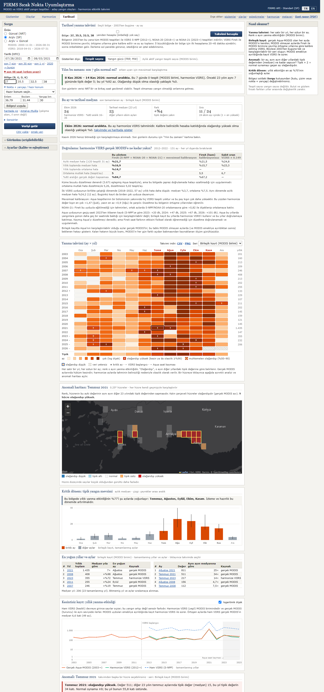
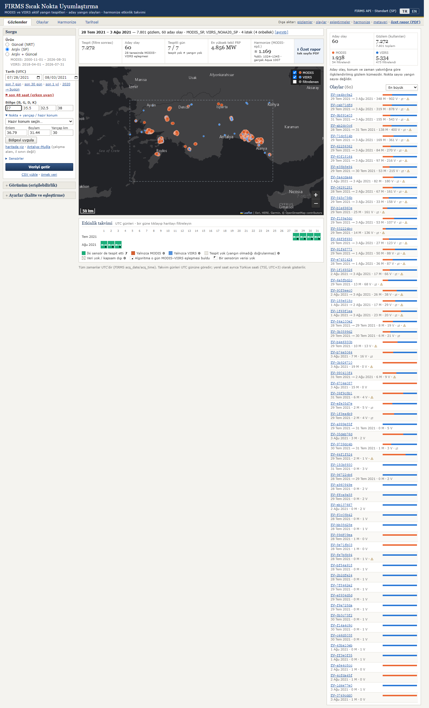
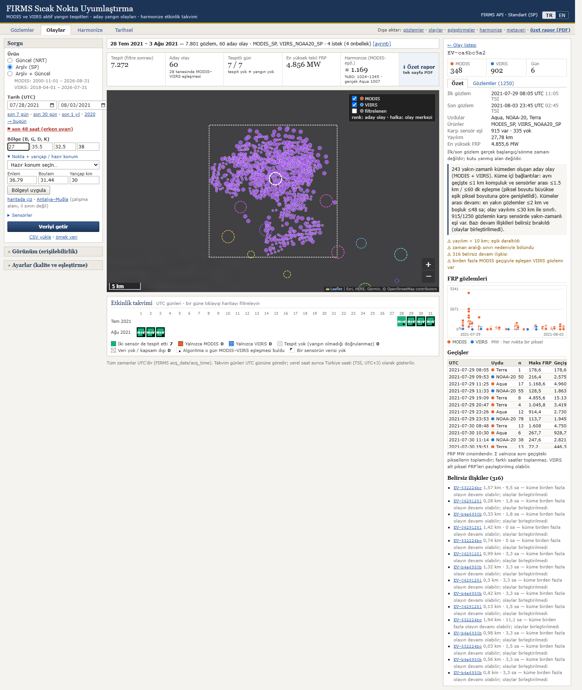
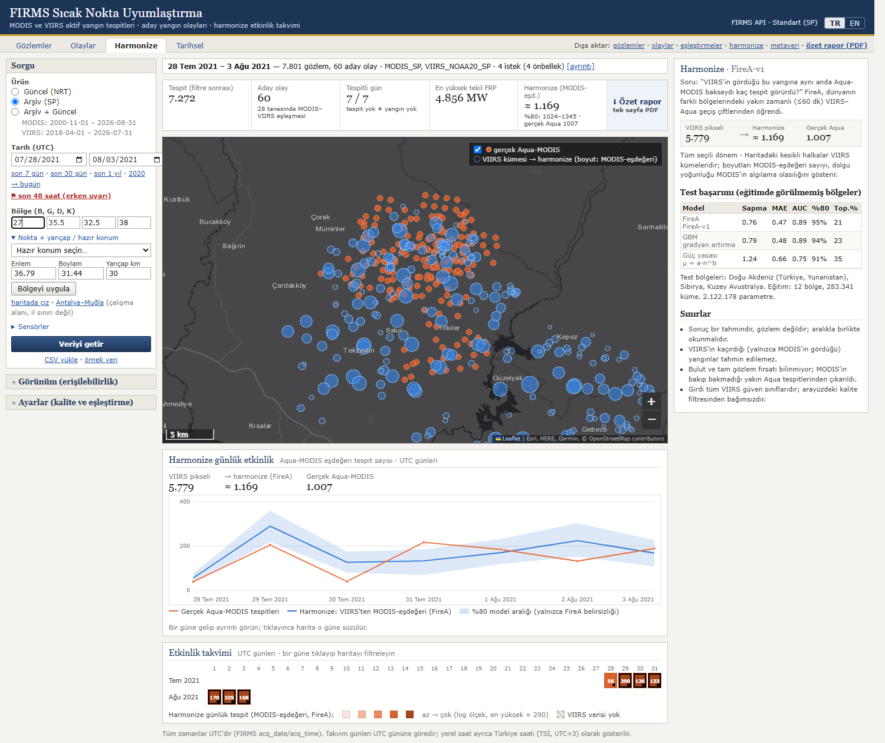
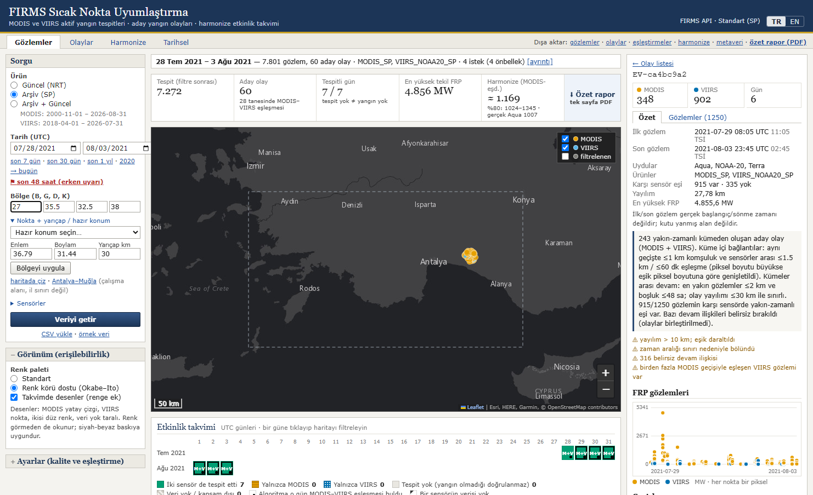
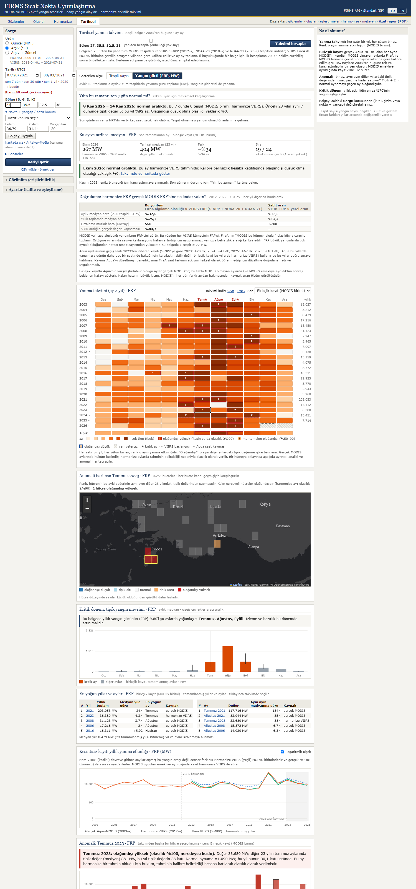
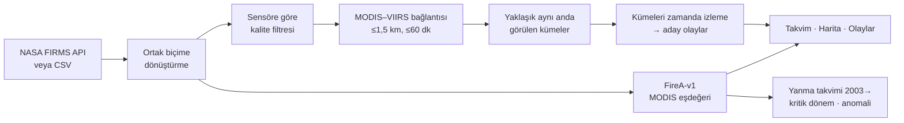
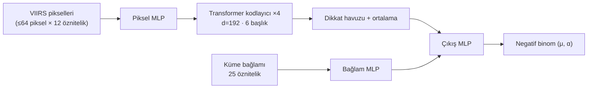

# FireA Harmonizer: MODIS ve VIIRS Yanma Etkinliği Takvimi

[English](README.md) · **Türkçe**

**NASA Space Apps Challenge 2026** kapsamında, **"Harmonization of MODIS and VIIRS Hot Spots"** görevi için hazırladığımız proje.

Uydular 20 yılı aşkın süredir aktif yangınları kaydediyor. Ancak bu kayıt iki farklı aletten, MODIS ve VIIRS'ten geliyor ve ikisinin sayıları doğrudan karşılaştırılamıyor. Geliştirdiğimiz web uygulaması:

1. VIIRS tespitlerini MODIS'e eşdeğer sayılara çeviriyor; böylece iki kayıt tek bir kayıtta birleştirilebiliyor,
2. bu birleşik kayıttan, kullanıcının seçtiği herhangi bir bölge için yanma etkinliği takvimi oluşturuyor.

Uygulama; geçmiş yangın mevsimlerini, olağandışı ayları ve kritik dönemleri incelemek isteyen erken uyarı ve acil müdahale ekipleri, bilim insanları ve arazi yöneticileri için tasarlandı.



---

## İçindekiler

1. [Sorun](#1-sorun)
2. [Uygulama ne yapıyor?](#2-uygulama-ne-yapıyor)
3. [Ekran görüntüleri](#3-ekran-görüntüleri)
4. [Nasıl çalışıyor?](#4-nasıl-çalışıyor)
5. [FireA-v1 modeli](#5-firea-v1-modeli)
6. [Yanma takvimi, kritik dönemler ve anomaliler](#6-yanma-takvimi-kritik-dönemler-ve-anomaliler)
7. [Erken uyarı, erişilebilirlik ve rapor](#7-erken-uyarı-erişilebilirlik-ve-rapor)
8. [Hızlı başlangıç](#8-hızlı-başlangıç)
9. [API uç noktaları](#9-api-uç-noktaları)
10. [FireA'yı yeniden eğitmek](#10-fireayı-yeniden-eğitmek)
11. [Proje yapısı](#11-proje-yapısı)
12. [Sınırlar](#12-sınırlar)
13. [Veri kaynakları ve kaynakça](#13-veri-kaynakları-ve-kaynakça)

---

## 1. Sorun

Uydular yangınları sıcak nokta olarak tespit eder: çevresinden çok daha sıcak olan pikseller.

- **MODIS**, Terra ve Aqua uydularında bulunur. Pikselleri yaklaşık 1 km genişliğindedir ve kaydı 2000 yılında başlar.
- **VIIRS**, Suomi NPP (2012'den beri), NOAA-20 (2018'den beri) ve NOAA-21 (2023'ten beri) uydularında bulunur. Pikselleri 375 m genişliğindedir; alan olarak yaklaşık 7 kat küçüktür. Bu yüzden çok daha küçük ve daha az sıcak yangınları da görebilir.

Bu nedenle aynı yangın MODIS'te 2, VIIRS'te 10'dan fazla sıcak nokta olarak görünebilir. İki kayıt art arda eklenirse, yerde hiçbir şey değişmediği halde yangın etkinliği 2012'de birden artmış gibi görünür. Ayrıca iki MODIS uydusu da görev sürelerinin sonuna yaklaşıyor. Uzun dönemli kaydın devam edebilmesi için VIIRS verisinin MODIS birimine çevrilmesi gerekiyor.

## 2. Uygulama ne yapıyor?

Uygulama dört sekmeli tek bir web sayfasıdır. Her sekmenin kendi adresi vardır (`#gozlemler`, `#olaylar`, `#harmonize`, `#tarihsel`), bu yüzden bir görünüm bağlantı olarak paylaşılabilir. Arayüz Türkçe ve İngilizce arasında değiştirilebilir (sağ üstte TR | EN); sunucu mesajları ve PDF rapor da seçilen dilde gelir.

| Sekme | Ne gösteriyor? |
|---|---|
| **Gözlemler** | Harita üzerinde ham MODIS ve VIIRS tespitleri; hangi gün hangi sensörün yangın gördüğünü gösteren günlük takvim |
| **Olaylar** | Açıklanabilir basit kurallarla gruplanan aday yangın olayları ve her olayın ayrıntıları (zaman çizelgesi, FRP grafiği, geçişler, belirsiz bağlantılar, ham kayıtlar) |
| **Harmonize** | FireA'nın Aqua-MODIS eşdeğeri sayıya çevirdiği VIIRS tespitleri; gerçek Aqua-MODIS ile gün gün karşılaştırma ve %80 belirsizlik bandı |
| **Tarihsel** | Yanma takvimi (ay × yıl, 2003'ten bugüne), yılın kritik dönemi, kesintisiz harmonize kayıt ve doğrulaması, olağandışı aylar, anomali haritası, aynı görünümlerin yangın yayınım gücü (FRP) için olanı, "yılın bu zamanı" kontrolü, son tamamlanan ayın tarihsel medyanla karşılaştırılması ve en yoğun yıllar ile aylar |

Diğer özellikler:

- **Bölge seçimi:** haritada kutu çizme, koordinat yazma, nokta ve yarıçap verme ya da Türkiye'deki hazır yangın bölgelerinden birini seçme.
- **Veri türleri:** yakın gerçek zamanlı veri (NRT), standart bilimsel arşiv (SP) veya ikisi birlikte. Uygulama bunları haber vermeden karıştırmaz; her gözlem ve her ay için hangi ürünün kullanıldığı kaydedilir.
- **Arka plan işleri:** indirme ve analizler arka planda çalışır, ilerlemesini gösterir ve iptal edilebilir. FIRMS istek sınırına takılınca uygulama bekleyip yeniden dener.
- **Dışa aktarım:** gözlemler (CSV), olay özeti (CSV), olay–gözlem bağlantıları (JSON), harmonize günlük seri (CSV), metaveri (JSON), yanma takvimi (CSV tablo ya da ekrandaki renklerle PNG resim) ve tek sayfalık PDF rapor. API anahtarı hiçbir dışa aktarıma yazılmaz.
- Arşiv dosyaları için **CSV yükleme** ve açıkça sentetik olarak etiketlenmiş örnek veri (`?ornek=1`).

## 3. Ekran görüntüleri

| | |
|---|---|
|  **Gözlemler:** 28 Tem – 3 Ağu 2021 (Manavgat ve Marmaris yangınları), gerçek FIRMS SP verisi |  **Olaylar:** bir aday olay; açıklaması, FRP değerleri ve geçişleri |
|  **Harmonize:** MODIS eşdeğeri sayıya çevrilmiş VIIRS ve gerçek Aqua-MODIS ile karşılaştırma |  **Erişilebilirlik:** renk körlüğüne uygun palet ve takvimdeki desenler |
|  **Tarihsel · FRP:** harmonize yangın yayınım gücü, doğrulaması ve anomali haritası | |

## 4. Nasıl çalışıyor?



### 4.1 Verinin FIRMS'ten alınması

- FIRMS **Area API** (`/api/area/csv/{KEY}/{SOURCE}/{B,G,D,K}/{GÜN}/{TARİH}`) ve **Data Availability API** kullanılıyor.
- Desteklenen ürünler: `MODIS_NRT`, `MODIS_SP`, `VIIRS_NOAA20_NRT`, `VIIRS_NOAA20_SP`, `VIIRS_SNPP_NRT`, `VIIRS_SNPP_SP`.
- Uygulama önce her ürünün hangi tarihleri kapsadığına bakar. Bu aralığın dışındaki günler indirilmez ve arayüzde işaretlenir. Uygulama kendiliğinden başka tarihlere geçmez.
- Uzun dönemler 5 günlük parçalara bölünüp paralel indirilir. Yanıtlar yerel bir SQLite önbelleğinde saklanır; aynı istek iki kez indirilmez. Güncel NRT verisi önbellekte 20 dakika kalır.
- Hatalar ayrı ayrı gösterilir: yanlış anahtar, istek sınırı (otomatik beklemeyle), zaman aşımı, ağ hatası, boş sonuç ve kapsam dışı gün.
- Anahtar yalnızca sunucuda okunur. Tüm loglarda ve hata mesajlarında gizlenir, tarayıcıya hiç gönderilmez.

### 4.2 Ortak veri biçimi

Her kayıt şu alanlara dönüştürülür:
`observation_id, source, satellite, instrument, latitude, longitude, observed_at_utc, frp_mw, confidence_raw, scan_km, track_km, daynight, version`.

Orijinal kayıt da yanında saklanır.

- `acq_date` ve `acq_time` (SSDD, UTC) birleştirilerek `observed_at_utc` elde edilir. Başında sıfır olmadan yazılmış saatler de doğru okunur (`631` → 06:31).
- FRP eksikse boş bırakılır, yerine 0 yazılmaz.
- `observation_id`, kaydın sabit bir özetidir (hash). Aynı veri yeniden indirildiğinde kopya oluşmaz. Aynı yerde farklı uydu veya saatte yapılmış tespitler korunur.
- Her sensörün kendi kalite filtresi vardır: MODIS için güven eşiği (0–100), VIIRS için `l/n/h` sınıfları. Bir ölçeği ötekine çevirmiyoruz.
- Statik ısı kaynakları, volkanlar ve deniz üstü tespitler (`type` 1–3) yanma takvimine katılmaz.

### 4.3 Aday olaylar

Olaylar birkaç basit kuralla oluşturulur; böylece her gruplamanın nedeni açıklanabilir:

| Adım | Kural | Varsayılan |
|---|---|---|
| Geçiş | bir uydunun kısa süre içinde art arda gelen tespitleri | 10 dk |
| MODIS–VIIRS bağlantısı | bir MODIS ve bir VIIRS tespiti arasındaki mesafe (Haversine) ve zaman farkı | ≤1,5 km, ≤60 dk (tarama alanının kenarındaki büyük MODIS piksellerinde daha geniş) |
| Aynı geçişte komşuluk | aynı geçişte yan yana olan pikseller | ≤1 km (piksel boyutuna göre) |
| Küme | süresi ve büyüklüğü sınırlı, birbirine bağlı gruplar | ≤90 dk, ≤10 km |
| Zamanda devam | kümeler arasındaki mesafe ve zaman boşluğu | ≤2 km, ≤48 sa, olay büyüklüğü ≤30 km |
| Belirsiz durumlar | bir küme iki olaya da ait olabiliyorsa daha yakın olana eklenir, diğer bağlantı belirsiz olarak saklanır; olaylar hiçbir zaman birleştirilmez | — |

- Bütün eşikler deneyseldir ve arayüzden değiştirilebilir.
- Bir olayın ilk ve son tespiti, yangının gerçek başlangıç ve bitiş zamanı değildir. Olayın kutusu da yanmış alanı göstermez.
- Günlük takvimde beş tür gün vardır: *iki sensör de*, *yalnızca MODIS*, *yalnızca VIIRS*, *tespit yok (bu, yangın olmadığını kanıtlamaz)* ve *veri yok / kapsam dışı*. Bir MODIS ve bir VIIRS tespitinin gerçekten bağlandığı günler ayrıca işaretlenir.
- FRP her tespit için MW olarak gösterilir. Farklı saatlerdeki değerler hiçbir zaman toplanmaz.

Hız: 26.000 tespitin bağlanması yaklaşık 6 saniye sürer. 73.000 tespitli 3 günlük bir dönem yaklaşık 20 saniye, FireA ise bunun üzerine yaklaşık 6 saniye sürer.

## 5. FireA-v1 modeli

FireA tek bir soruyu cevaplar: *VIIRS'in gördüğü bu yangına aynı anda Aqua-MODIS baksaydı kaç tespit görürdü?*

FireA, her VIIRS kümesi (bir geçişteki birbirine yakın pikseller) için tek bir sayı vermez. MODIS tespit sayısı için bir olasılık dağılımı (negatif binom) verir. Bu dağılımdan şunları hesaplıyoruz:

- beklenen MODIS tespit sayısı, ve
- MODIS'in bu kümeyi hiç görüp görmeyeceğinin olasılığı.

### 5.1 Eğitim verisi

- **Ürünler:** NASA FIRMS arşiv ürünleri MODIS C6.1, VIIRS S-NPP ve VIIRS NOAA-20, 2019–2024.
- **Bölgeler:** farklı yangın türlerine sahip 15 bölge (Akdeniz, boreal orman, savan, tropikal orman, tarım yakmaları, turbalık). Her bölgeden 50 gün aldık: 26'sı yangın mevsiminden, 24'ü yılın 12 ayına yayılmış. Böylece model kışı ve sakin dönemleri de görüyor. Toplamda 2.250 istek ve 3,58 milyon tespit kullanıldı.
- **Etiket:** zamanca en yakın Aqua geçişinde (en fazla 60 dakika fark) VIIRS kümesinin üzerine düşen Aqua-MODIS tespiti sayısı.
- **MODIS oraya baktı mı?** Sıcak nokta dosyaları, uydunun bir bölgeye bakıp bakmadığını ya da havanın bulutlu olup olmadığını söylemez. Bir kümeyi yalnızca, aynı geçişte 10–1.000 km uzakta başka Aqua tespitleri varsa kullandık; bu, MODIS'in o bölgeyi görüntülediğini gösterir. Kümenin kendi üzerindeki tespitleri saymadık; sayarsak kümenin veriye girip girmemesine etiket karar vermiş olurdu.
- **Diğer girdiler:** küme boyutu, FRP, parlaklık, güven sınıfı, bakış geometrisi, yerel saat, mevsim (yarıküre dikkate alınarak), mutlak enlem ve aynı geçişte 25 km içindeki VIIRS piksel sayısı.
- **Veri miktarı:** 1.264.656 küme; bunların 1.062.634'ü kullanılabildi. Bölge başına en fazla 50.000 kümeyle eğitim için 283.341, doğrulama için 55.423, test için 61.064 küme ayrıldı.
- **Test bölgeleri:** Doğu Akdeniz, Sibirya ve Kuzey Avustralya. Değerlendirdiğimiz model bu bölgeleri hiç görmedi.
- **Uygulamadaki model:** Doğu Akdeniz dışındaki bütün bölgelerle yeniden eğitildi (389.974 küme). Bu bölgeyi dışarıda tuttuk ki Antalya–Muğla dahil oradaki kontrollerimiz bağımsız kalsın.

Uyumlaştırmanın neden gerekli olduğu verinin kendisinde de görülüyor: tek pikselli VIIRS kümelerinin yalnızca **%8**'ini MODIS de tespit ediyor; 20'den fazla pikselli kümelerde bu oran **%66**.

### 5.2 Model



- **Türü ve boyutu:** 2.122.178 parametreli bir set transformer. Set transformer, bir kümenin piksellerini sırası önemli olmayan bir grup olarak ele alır; bu da yangın kümelerine uygundur.
- **Eğitim:** negatif binom kaybı, AdamW optimizasyonu, 5 epoch, 512'lik yığınlar, sıradan bir bilgisayarın işlemcisinde (son model için yaklaşık 30 dakika).
- **Uygulamada kullanımı:** iki uydunun aynı anda baktığını varsayıyoruz (Δt = 0). MODIS'in yangını hangi açıdan göreceğini bilmediğimiz için 16 tipik piksel boyutu için tahmin yapıp ortalamasını alıyoruz. Günlük ve aylık toplamların %80 aralıkları Monte Carlo yöntemiyle hesaplanıyor.

### 5.3 Test bölgelerindeki sonuçlar (61.064 küme)

FireA'yı iki daha basit yöntemle karşılaştırdık:

| Model | Poisson sapması ↓ | MAE ↓ | Algılama AUC ↑ | Brier ↓ | %80 aralık kapsaması | Bölge-gün toplam hatası (medyan) ↓ |
|---|---|---|---|---|---|---|
| Güç yasası (μ = a·n^b) | 1,243 | 0,663 | 0,754 | 0,165 | %90,8 | %35,4 |
| Gradyan artırma (Poisson) | 0,788 | 0,478 | 0,889 | 0,113 | %93,8 | %22,5 |
| **FireA-v1** | **0,764** | **0,468** | **0,891** | **0,111** | %94,9 | **%20,9** |

Bu sayıların anlamı:

- FireA, basit güç yasasından açıkça daha iyi (sapma %39 daha düşük).
- Gradyan artırmadan her ölçütte daha iyi, ancak fark küçük (sapma %3 daha düşük).
- %80 aralıkları biraz fazla geniş: gerçek değerlerin yaklaşık %95'i bu aralıkların içinde kalıyor.
- Bütün test kümelerinde FireA 35.426 MODIS tespiti öngördü; gerçek sayı 34.634 (+%2,3).

### 5.4 İki sensörü bir araya getirebiliyor mu? (Antalya–Muğla, 2012–2022)

- İki sensörün birlikte çalıştığı ve en az 20 tespit olan 49 ayda, ham VIIRS gerçek Aqua-MODIS'ten medyan olarak **6,6 kat** fazla tespit bildirdi. FireA-v1 sonrasında, hiçbir yerel kalibrasyon yapılmadan, bu oran **0,91**.
- Büyük yangın ayları gerçeğe yakın çıkıyor. Ağustos 2021 için FireA 771 tespit veriyor; gerçek Aqua-MODIS 811 tespit bildirdi (−%5).
- Sakin aylarda doğruluk daha düşük. Örneğin Ağustos 2016 için FireA 17 veriyor, gerçek değer 6.
- Yöntemin tamamının her seferinde bir yıl dışarıda bırakılarak yapılan doğrulaması bölüm 6.4'te.
- **Örnek bir hafta (Manavgat, 28 Temmuz – 3 Ağustos 2021):**
  - FireA-v1, NOAA-20 verisinden 1.169, S-NPP verisinden 1.080 tespit öngörüyor. Aqua-MODIS gerçekte 1.007 tespit bildirdi (+%16,1 ve +%7,2).
  - Sabit oran (VIIRS pikseli başına 0,149 MODIS tespiti) 859 veriyor (−%14,7).
  - Çok büyük bir yangının olduğu tek bir haftada FireA sabit orandan açıkça daha iyi değil. Üstünlüğü sakin dönemlerde, belirsizlik tahmininde ve birden fazla uydunun ortalaması alındığında ortaya çıkıyor.

Daha fazla ayrıntı: [`backend/models/FireA-v1/MODEL_CARD.tr.md`](backend/models/FireA-v1/MODEL_CARD.tr.md).

## 6. Yanma takvimi, kritik dönemler ve anomaliler

**Tarihsel** sekmesi, seçilen bölgenin tüm kaydını üç adımda oluşturur:

1. 2003'ten bu yana bütün MODIS tespitlerini ve üç uydunun VIIRS tespitlerini indirir: S-NPP 2012'den, NOAA-20 2018'den, NOAA-21 2023'ten itibaren. Arşiv (SP) varsa onu, yoksa NRT verisini kullanır.
2. VIIRS'i FireA ile MODIS birimine çevirir ve sonucu iki sensörün birlikte çalıştığı yıllara göre kalibre eder.
3. Her şeyi ay ay toplar: hem **tespit sayısı** hem **yangın yayınım gücü (FRP, MW)** olarak.

Üstteki bir düğme bütün görünümleri tespit sayısı ile FRP arasında değiştirir. Yanma takvimi CSV tablo (her ay için bütün seriler, kaynak, %80 aralık ve olağandışılık) ya da ekrandaki renklerle aynı PNG resim olarak indirilebilir.

| Görünüm | Cevapladığı soru |
|---|---|
| **Doğrulama** | Bu bölgede harmonize VIIRS gerçek MODIS'e ne kadar yakın? (her seferinde bir yıl dışarıda bırakılarak test edilir; ham model ve basit sabit oranla karşılaştırılır) |
| **Yanma takvimi (ay × yıl)** | 2003'ten bu yana hangi ayda ne kadar yangın oldu? Olağandışı aylar işaretlidir; harmonize aylarda işaret bir olasılığa dayanır |
| **Anomali haritası** | Seçilen ayda bölgenin hangi kısımları olağandışıydı? Bölge yaklaşık 0,25°'lik hücrelere bölünür (en fazla 24 × 16) ve her hücre aynı aydaki kendi geçmiş değerleriyle karşılaştırılır |
| **Kritik dönem** | Olağan yangın mevsimi ne zaman? Aylık medyanlar ve yayılımları; yıllık etkinliğin birlikte en az %70'ini taşıyan aylar kritik olarak işaretlenir |
| **Kesintisiz kayıt** | 2003'ten bugüne yıllık toplamlar: gerçek MODIS, harmonize VIIRS (MODIS biriminde) ve ham VIIRS. Ham seride 2012'deki sıçramanın nedeni sensör değişikliğidir |
| **Tek ay** | Tıklanan ay için: değeri, aynı ayın diğer yıllardaki tipik değeri, "olağandışı" eşiği ve harmonize aylarda olasılık |
| **Sensör uyumu** | Yıllar boyunca harmonize VIIRS (%80 aralığıyla) o ay için gerçek MODIS ile örtüşüyor mu? |
| **Yılın bu zamanı** | Son 7 günün, önceki yılların aynı 7 günüyle karşılaştırılması; erken uyarı için |
| **Bu ay ve tarihsel medyan** | Son tamamlanan ay, diğer bütün yılların aynı ayına göre nasıl? Değer, tarihsel medyan, fark, sıra ve hüküm (harmonize aylarda olasılıkla birlikte) |
| **En yoğun yıllar ve aylar** | En yoğun beş yıl ve beş ay; her biri tipik bir yıl ya da ayla karşılaştırılır ve gerçek MODIS mi harmonize VIIRS mi olduğu belirtilir |

### 6.1 Hangi uyduları kullanıyoruz ve NOAA-21 neden dahil?

Görev, **MODIS** ve **VIIRS** kayıtlarıyla ilgili. Bunlar uydu değil, alet adlarıdır:

- **MODIS** Terra ve Aqua'da bulunur. Referans olarak **Aqua**'yı kullanıyoruz, çünkü VIIRS gibi öğleden sonra geçiyor. Terra ise sabah geçiyor.
- **VIIRS** aynı alet tasarımına ve aynı 375 m yangın algoritmasına sahip üç uyduda bulunur: **Suomi NPP** (2012→), **NOAA-20 / JPSS-1** (2018→) ve **NOAA-21 / JPSS-2** (2023→). Üçü de NASA FIRMS'in yayımladığı VIIRS sıcak nokta kayıtlarıdır; bu yüzden NOAA-21'i kullanmak görevin kapsamı içinde kalıyor.

NOAA-21 gelecek için önemli. S-NPP en eski VIIRS uydusu ve MODIS durduktan sonra kaydın daha yeni uydularla devam etmesi gerekecek.

Uyduları şöyle birleştiriyoruz:

- FireA her VIIRS uydusu için ayrı çalıştırılır ve aylık sonuçların ortalaması alınır, toplanmaz. Her uydu aynı yangınları kendi başına gördüğü için ortalama almak rastgele hatayı azaltır. NOAA-20'yi eklemek, 103 ortak ayda aylık hatayı %30,8'den %27,5'e düşürdü.
- FireA yalnızca S-NPP ve NOAA-20 verisiyle eğitildi ve NOAA-21'den yaptığı ham tahminler S-NPP'dekinden %16 yüksek çıktı. NOAA-21'i Aqua ile de karşılaştıramıyoruz, çünkü NOAA-21 başladığında Aqua'nın yörüngesi kaymaya başlamıştı.
- Bu yüzden ortalama alınmadan önce NOAA-21, ortak aylardaki toplamı S-NPP/NOAA-20 ortalamasına eşit olacak şekilde ölçeklenir. Antalya–Muğla bölgesinde bu çarpan ×0,82. Ay ay bakıldığında NOAA-21, S-NPP'yi çok yakından izliyor (log korelasyon 0,975). Bir bölgede 6'dan az ortak ay varsa NOAA-21 kullanılmaz.
- Karşılaştırma için gösterilen "ham VIIRS" serisinde yalnızca S-NPP kullanılır; böylece seri 2012'den itibaren hep aynı sensörden gelir.

### 6.2 Harmonize kayıt nasıl oluşturuluyor?

1. **Küme boyutu düzeltmesi (yalnızca işe yarıyorsa).** İki sensörün birlikte çalıştığı yıllarda uygulama her Aqua tespitini en yakın VIIRS pikseliyle eşleştirir (±90 dakika ve MODIS piksel boyutu içinde). Sonra eşleşen sayıları FireA'nın beş farklı küme boyutu için, gündüz ve gece ayrı olarak verdiği tahminlerle karşılaştırıp düzeltme çarpanları hesaplar. Bu çarpanlar yalnızca, bir yılı dışarıda bırakarak yapılan testte hatayı düşürüyorsa kullanılır. Antalya–Muğla bölgesinde düşürmüyor (ortalama mutlak hata düzeltmeyle 5,26, düzeltmesiz 5,02), bu yüzden orada kullanılmıyor.
2. **Mevsimsel kalibrasyon.** Çalışma bölgesindeki Aqua tespitlerinin yaklaşık üçte birinin (2012–2022'de %32) yakınında hiç VIIRS tespiti yok. Bu oran kış ve ilkbaharda %60–80, Temmuz ve Ağustos'ta ise yalnızca %13–20. FireA bu tespitleri VIIRS kümelerinden tahmin edemez. Bunun yerine uygulama, iki sensörün birlikte çalıştığı aylardan düzgün bir mevsimsel çarpan öğrenir (yılda bir dalga yapan bir sinüs eğrisi; Poisson modeli ve düzenlileştirme ile). Çalışma bölgesinde bu çarpan küçük: Şubat'ta ×1,47, Ağustos'ta ×0,90. 36'dan az ortak ay varsa bunun yerine tek bir genel çarpan kullanılır.
3. **Harmonize FRP.** MODIS yalnızca tespit ettiği yangınların FRP'sini ölçer. Bu yüzden uygulama her VIIRS kümesinin FRP'sini, FireA'nın "MODIS bu kümeyi tespit eder" olasılığıyla çarpıp bunları toplar. FRP'yi mevsime göre ya da genel bir çarpanla kalibre etmek testlerimizde hatayı artırdı; bu yüzden FRP ölçeklenmeden kullanılıyor, yalnızca belirsizlik aralığı kalibre ediliyor.
4. **Kalibre belirsizlik.** %80 aralıklar, iki sensörün birlikte çalıştığı yıllardaki gerçek aylık hatalardan hesaplanır. Aralığın genişliği değerin büyüklüğüne bağlıdır ve gerçek değerlerin %80'i içine düşecek şekilde ayarlanır. Modelin kendi aralıkları gerçek değerlerin yalnızca %63'ünü kapsıyordu.
5. **Aqua'nın yörünge kayması.** Aqua 2022'de alışılmış yörünge grubundan (A-Train) ayrıldı ve o zamandan beri her yıl daha geç geçiyor. Uygulama bunu, Aqua ile S-NPP'nin tipik yerel geçiş saatlerini karşılaştırarak veriden ölçer. Çalışma bölgesinde gecikme 2023'te 20, 2024'te 47, 2025'te 67, 2026'da 101 dakika. 15 dakikadan fazla kaymış yıllar kalibrasyon ve doğrulamada kullanılmaz; bu yıllar için birleşik kayıt harmonize VIIRS'i kullanır.
6. **Birleşik kayıt (MODIS biriminde).** Birleşik kayıt, karşılaştırılabildiği her yerde gerçek Aqua-MODIS'i, geri kalan her yerde kalibre harmonize VIIRS'i kullanır: kaymış yıllarda, MODIS verisinin eksik olduğu aylarda ve ileride MODIS durduktan sonra.

**Kaymış Aqua verisini neden düzeltmiyoruz?** FireA'nın bunu yapıp yapamayacağını, Δt = 0 yerine Aqua ile VIIRS arasındaki gerçek saat farkını vererek test ettik. Yapamadı. Gerçek saat farkıyla 2024–2025 tahminleri artmak yerine biraz azaldı (Aqua'ya oran 0,85 → 0,83 ve 0,80 → 0,80); yani model yangınların gün içinde nasıl değiştiğini öğrenmemiş. Doğrudan veriden alınan basit bir çarpan da denedik, ancak kaymanın etkisi (−%15 ile −%20 arası) yıllar arasındaki normal farklarla aynı büyüklükteydi (2022'de hiç kayma yokken −%18). Bu yüzden kaymış Aqua verisi uygulamada gösteriliyor ama referans olarak kullanılmıyor.

### 6.3 Olağandışı aylar

- **Tipik değer:** aynı ayın diğer yıllardaki medyanı. **Normal oynama:** 1,4826 × medyan mutlak sapma, ama en az 5 tespit (veya FRP karşılığı); böylece çok sakin aylar küçük değişimler yüzünden işaretlenmez.
- **Gerçek MODIS verisi olan aylarda** sonuç kesindir: *tipik + 2 × oynama* üstü **olağandışı yüksek**, *tipik − 2 × oynama* altı **olağandışı düşük** sayılır.
- **Harmonize aylarda** değerin kendisi bir tahmindir. Uygulama kalibre hatayı kullanarak gerçek MODIS değerinin eşiğin ötesinde olma **olasılığını** hesaplar; örneğin "olağandışı yüksek, olasılık %93". Takvimde "!" en az %90'ı, "?" %50–90'ı gösterir.
- Anomali haritası her hücre için aynı yöntemi kullanır; küçük hücrelerdeki sayılar daha çok oynadığı için alt sınır 3 tespittir.
- Günlerinin %90'ından azında veri olan aylar boş (taralı) bırakılır. "Tespit yok" hiçbir zaman "yangın yok" olarak yorumlanmaz.

### 6.4 Örnek: Antalya–Muğla (27–32,5° D, 35,5–38° K), 2003 – Kasım 2026

Yöntemi 2012–2022 için gerçek Aqua-MODIS'e karşı, her seferinde bir yılı dışarıda bırakarak test ettik: her şey diğer yıllardan öğrenilir ve dışarıda bırakılan yılla karşılaştırılır. Toplam 131 ay var; yüzde hatalar en az 20 tespitli 31 ay için verilmiştir.

| Tespit sayısı | **Bizim yöntem** (FireA-v1, S-NPP + NOAA-20 + NOAA-21, mevsimsel kalibrasyon) | Kalibrasyonsuz FireA-v1 | Sabit oran (VIIRS × 0,149) |
|---|---|---|---|
| Aylık medyan hata | **%21,7** | %21,5 | %24,8 |
| Yıllık toplamlarda medyan hata | **%16,9** | %15,7 | %23,3 |
| Yıllık toplamlarda ortalama hata | **%14,7** | — | — |
| Ortalama mutlak hata (ayda tespit) | **5,0** | 5,5 | 6,7 |
| %80 aralığın içinde kalan gerçek değerler | **%84,7** | %67,2 | — |

FireA-v1 kalibrasyon olmadan da gerçek değerlere yakın. Mevsimsel kalibrasyon esas olarak mutlak hatayı düşürüyor ve aralıkları güvenilir hale getiriyor.

İki VIIRS uydusunun bulunduğu 2018–2022 döneminde (57 ay) yıllık toplamların hatası çok daha küçük: medyan %3,7, ortalama %7,5. Bu dönemde aylık medyan hata %24,2 (en az 20 tespitli 12 ay).

| FRP | **Bizim yöntem** (FireA algılama olasılığı × VIIRS FRP) | Sabit oran (VIIRS FRP × yerel oran) |
|---|---|---|
| Aylık medyan hata | **%37,5** | %72,5 |
| Yıllık toplamlarda medyan hata | **%25,2** | %64,4 |
| Ortalama mutlak hata (ayda MW) | **550** | 1.200 |
| %80 aralığın içinde kalan gerçek değerler | **%84,7** | — |

Kaydın bu bölge için gösterdikleri:

- **Ham VIIRS ve MODIS:** ikisinin birlikte çalıştığı aylarda ham VIIRS, Aqua-MODIS'ten medyan olarak 6,6 kat fazla tespit bildirdi. Ham kayıtları birleştirmek 2012'de sahte bir sıçrama yaratırdı.
- **Kritik dönem:** yıllık tespitlerin %77'si Temmuz–Kasım arasında. Yıllık yangın gücünün %80'i ise Temmuz–Eylül'de, çünkü en büyük yangınlar yaz ortasında çıkıyor.
- **Olağandışı aylar:** 27 ay olağandışı yüksek olarak işaretleniyor (kesin olarak ya da en az %90 olasılıkla). Aralarında Temmuz–Ağustos 2008 ve Manavgat yangınının olduğu Temmuz–Ağustos 2021 var (tipik değerler 15 ve 33 iken 511 ve 811 tespit). Temmuz 2021 anomali haritası Manavgat ve Marmaris çevresindeki hücreleri işaretliyor.
- **Büyük yangın ayları:** harmonize VIIRS Temmuz 2021 için 567 (gerçek Aqua: 511), Ağustos 2021 için 771 (gerçek: 811) veriyor. İki gerçek değer de %80 aralıkların içinde (479–671 ve 654–909).
- **Aqua'nın kaymasından sonraki aylar:** Temmuz 2023 %99'un üzerinde, Eylül 2025 ise %53 olasılıkla olağandışı yüksek.

Kalan aylık hatanın (tespit sayısında yaklaşık %20, FRP'de %38) iki ana nedeni var. Birincisi yalnızca MODIS'in gördüğü tespitler; VIIRS bunlar hakkında bize hiçbir bilgi vermiyor. İkincisi ölçüm gürültüsü: MODIS bir yangını her gün farklı bir açıdan ve farklı piksel boyutuyla görüyor, büyük yangınların FRP'si de bir geçişten diğerine çok değişiyor. Küme düzeyinde makine öğrenmesi düzeltmeleri, küçük ve yalnızca MODIS'in gördüğü tespitler için ayrı bir model ve VIIRS uydularını ortak yangın nesnelerinde birleştirmeyi de denedik. Hiçbiri, bir yılı dışarıda bırakarak yapılan testte yukarıdaki yöntemden daha iyi sonuç vermedi.

İl büyüklüğünde bir bölge için ilk hesaplama yaklaşık 20–45 dakika sürüyor, çünkü uygulama istek sınırına uyarak FIRMS'ten yaklaşık 4.000 parça indiriyor. Sonrasında sonuçlar önbellekten geliyor.

## 7. Erken uyarı, erişilebilirlik ve rapor

- **Erken uyarı:**
  - "Son 48 saat" en yeni NRT verisini seçer.
  - Sayfa kendini 30 dakikada bir yenileyebilir; yeni bir NRT günü gelince zaman penceresi ileri kayar.
  - Yeni yangın tespit edildiğinde tarayıcı masaüstü bildirimi gösterebilir.
  - Olaylar en yeni tespite veya en yüksek FRP'ye göre sıralanabilir. Son 12 saatte tespiti olan olaylar **YENİ** etiketi alır.
  - "Yılın bu zamanı" kontrolü son 7 günü önceki yıllarla karşılaştırır.
  - NRT verisi geçişten yaklaşık 3 saat sonra gelir ve bildirimler yalnızca sayfa açıkken çalışır.
- **Dil:** Türkçe veya İngilizce, istendiği an değiştirilebilir. Tarayıcı seçimi hatırlar.
- **Erişilebilirlik:**
  - Standart palet ya da renk körlüğüne uygun Okabe–Ito paleti.
  - Takvimde renklerin yanında desenler de kullanılır (MODIS için çizgi, VIIRS için nokta, eksik veri için tarama).
  - Yanma takvimi tek bir rengin tonlarını kullanır; olağandışı aylar çerçeveyle gösterilir.
- **Rapor:** "Özet rapor (PDF)" ana sayıları, günlük grafikleri, en büyük olayları ve sınırları içeren tek sayfalık bir özet indirir.

## 8. Hızlı başlangıç

**Gerekenler:** Python 3.11 veya üstü, Node.js 18 veya üstü ve ücretsiz bir [NASA FIRMS MAP_KEY](https://firms.modaps.eosdis.nasa.gov/api/map_key/).

```bash
# 1) anahtarı ekle (.env dosyasını asla Git'e ekleme)
cp .env.example .env            # sonra .env içinde: FIRMS_MAP_KEY=...

# 2) backend
cd backend
python -m venv .venv
# Windows: .venv\Scripts\activate    macOS/Linux: source .venv/bin/activate
pip install -r requirements.txt
pip install torch --index-url https://download.pytorch.org/whl/cpu   # FireA için gerekli
python -m uvicorn app.main:app --port 8000

# 3) frontend (ikinci bir terminalde)
cd frontend
npm install
npm run dev                     # http://localhost:5173
```

- Backend, proje klasöründeki `.env` dosyasından `FIRMS_MAP_KEY` (veya `MAP_KEY`) değişkenini okur.
- Anahtar olmadan da uygulama CSV yükleme ve sentetik örnek veriyle çalışır (`http://localhost:5173/?ornek=1`).
- Testler: `cd backend && python -m pytest -q` (61 test).

## 9. API uç noktaları

| Yöntem | Uç nokta | Açıklama |
|---|---|---|
| GET | `/api/health` | durum ve anahtarın tanımlı olup olmadığı |
| GET | `/api/availability` | FIRMS ürünlerinin tarih aralıkları |
| POST | `/api/fetch` | indirme ve analiz işi başlatır |
| POST | `/api/analyze_job` | analizi yeni ayarlarla yeniden çalıştırır (iş) |
| POST | `/api/climatology_job` | bir bölge için 2003'ten bugüne yanma takvimi (iş) |
| GET | `/api/jobs/{id}` · POST `/api/jobs/{id}/cancel` | iş durumu / işi iptal etme |
| POST | `/api/upload` · `/api/sample` | CSV yükleme · sentetik örnek |
| GET | `/api/observations` · `/api/event` · `/api/observation` | harita noktaları, olay ayrıntısı, gözlem ayrıntısı |
| GET | `/api/virtual_modis` | harita için FireA kümeleri |
| GET | `/api/export?kind=observations\|events\|links\|virtual_modis\|metadata` | dışa aktarımlar |
| GET | `/api/report` | tek sayfalık PDF özet |

## 10. FireA'yı yeniden eğitmek

```bash
cd backend
python -m firea.download        # yaklaşık 2.250 FIRMS isteği, önbelleğe kaydedilir
python -m firea.build_dataset   # etiketler ve öznitelikler → firea/data/dataset.npz
python -m firea.train --epochs 5   # değerlendirme modeli + son model → models/FireA-v1/
python -m firea.model_card      # MODEL_CARD.md ve MODEL_CARD.tr.md
```

PDF rapor Windows'ta Arial, Linux'ta DejaVu yazı tipini kullanır. İkisi de bulunamazsa Helvetica kullanılır.

## 11. Proje yapısı

```
backend/
  app/            FastAPI sunucusu: FIRMS istemcisi, veri dönüştürme, eşleştirme, analiz,
                  FireA tahminleri, yanma takvimi ve anomaliler, PDF rapor
  firea/          FireA veri indirme, öznitelik ve etiketler, model, eğitim, model kartı
  models/FireA-v1  ağırlıklar (8,5 MB), ayarlar, metrikler, model kartı
  tests/          pytest testleri
frontend/
  src/            React + TypeScript + Vite + Leaflet tek sayfalık arayüz
docs/
  screenshots/
```

## 12. Sınırlar

- Sıcak nokta dosyalarında bulut bilgisi ya da uydunun bir bölgeye bakıp bakmadığı bilgisi yoktur. "Tespit yok", "yangın yok" demek **değildir**.
- Eşleştirme eşikleri deneyseldir. Olaylar doğrulanmış yangınlar değil, olası gruplamalardır.
- FireA'nın çıktıları **Aqua-MODIS biriminde tahminlerdir**. Yalnızca MODIS'in gördüğü yangınlar VIIRS'ten yeniden oluşturulamaz.
- Doğruladığımız bölgede harmonize aylık değerler gerçek MODIS'ten ortalama yaklaşık ±%20 farklı (yıllık toplamlarda yaklaşık ±%13, iki VIIRS uydusu varken yaklaşık ±%6). Uygulama bu hatayı her bölge için Doğrulama kartında gösterir. 36'dan az ortak ayı olan bölgelerde yalnızca genel bir çarpan ve varsayılan bir belirsizlik kullanılır.
- Çalışma bölgesindeki Aqua tespitlerinin yaklaşık üçte birinin VIIRS'te karşılığı yok. Bunlar yalnızca ortalama olarak, mevsimsel çarpan üzerinden temsil edilir; bu yüzden yalnızca MODIS'in gördüğü küçük tespitlerdeki olağandışı değişimler yakalanmaz.
- Küme boyutu düzeltmesi bölgede en az 30 eşleşmiş Aqua tespiti gerektirir ve yalnızca hatayı düşürdüğü yerde kullanılır.
- Mevsimsel kalibrasyon 2012–2022 verisinden öğrenilir ve MODIS bittikten sonra MODIS ile VIIRS arasındaki ilişkinin değişmeyeceğini varsayar.
- Harmonize sekmesinde (kullanıcının seçtiği kısa dönemler) %80 bant yalnızca modelin kendi belirsizliğini gösterir. Kalibre aralıklar Tarihsel sekmesindedir.
- Harmonize FRP'nin aylık hatası (yaklaşık %38) tespit sayısından büyüktür, çünkü büyük yangınların FRP'si geçişten geçişe çok değişir.
- Aqua'nın kaydığı yıllar (2023 ve sonrası) düzeltilmez; birleşik kayıt bu yıllar için harmonize VIIRS'i kullanır. NOAA-21, kayma öncesi Aqua ile karşılaştırılamadığı için S-NPP/NOAA-20'ye göre ölçeklenir.
- Harmonize aylardaki olasılıklar kalibre aylık hatayı hesaba katar, ancak tipik değerin kendi belirsizliğini katmaz.
- Büyük bir bölge için ilk yanma takvimi yavaş hesaplanır, çünkü FIRMS'in gün gün sorgulanması gerekir.

## 13. Veri kaynakları ve kaynakça

- Aktif yangın verisi: **NASA FIRMS** (MODIS Collection 6.1 ve VIIRS 375 m aktif yangın ürünleri).
- Altlık harita: **Esri** World Dark Gray (Esri, HERE, Garmin, © OpenStreetMap katkıcıları).
- Kaynaklar: Giglio vd. 2016 (MODIS Collection 6 aktif yangın ürünü); Schroeder vd. 2014 (VIIRS 375 m aktif yangın ürünü); Lee vd. 2019 (Set Transformer).

NASA Space Apps Challenge 2026 için hazırlandı.

---

**Yapay zekâ beyanı:** Kodlama, hata ayıklama ve dokümantasyon yazımında yapay zekâ asistanlarından (Claude ve ChatGPT) yardım aldık.
